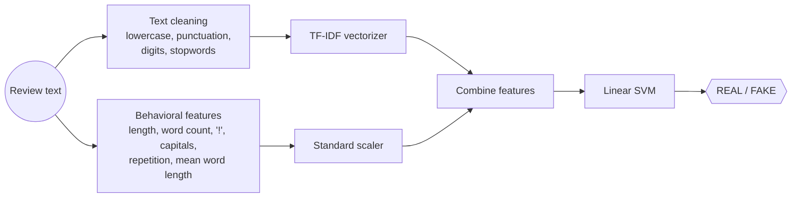
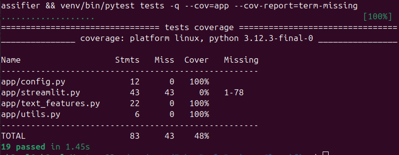

<h1 align="center">🕵️ Fake Review Detector</h1>
<p align="center">Paste a product review and find out if it looks <b>real</b> or <b>computer-generated / fake</b>.<br/>
<b>Python · NLP · scikit-learn · Streamlit · FastAPI · Docker · pytest</b></p>
<p align="center"><a href="https://fakerealreviewsclassifier.streamlit.app/"><b>▶ Try the live demo</b></a></p>

---

## Problem

Online stores are flooded with fake reviews that mislead buyers and hurt honest sellers. Reading every review by hand to spot them does not scale.

## Solution

A lightweight NLP classifier that combines **what a review says** (TF-IDF on cleaned text) with **how it is written** (length, exclamation marks, capital letters, word repetition). A Linear SVM trained on a labeled fake-reviews dataset returns a REAL / FAKE verdict instantly in a web app.

## Architecture



## How it works

Everything below is one scikit-learn `Pipeline` (trained in `notebooks/pipeline.ipynb`, saved as `models/review_pipeline.joblib`), so the app runs exactly the code it was trained with.

1. **Cleaning:** lowercase, strip punctuation and digits, remove English stop words (`app/text_features.py`).
2. **Text features:** TF-IDF (unigrams + bigrams) on the cleaned review.
3. **Writing-style features:** 6 numbers computed on the raw text (length, word count, `!` count, capital ratio, repetition, mean word length), standardised.
4. **Classification:** both feature sets are combined and passed to a Linear SVM.

## HTTP API

The same pipeline is also served by a small FastAPI app (`app/api.py`):

```bash
cd app
uvicorn api:app --port 8000    # interactive docs: http://localhost:8000/docs
curl -X POST localhost:8000/predict -H "Content-Type: application/json" -d '{"text": "BEST PRODUCT EVER!!! BUY NOW!!!"}'
# {"label":"FAKE"}
```

| Endpoint | Purpose |
|---|---|
| `GET /health` | Process is alive (Kubernetes liveness probe) |
| `GET /ready` | Model is loaded, traffic can be sent (readiness probe); `503` until then |
| `POST /predict` | `{"text": "..."}` → `{"label": "REAL" \| "FAKE"}`; empty or non-string text → `422` |

## Tests and type checks

```bash
pip install -r requirements-dev.txt
pytest tests --cov=app --cov-report=term-missing
mypy        # settings in mypy.ini
```

Unit tests cover the text cleaning, every behavioral feature, the prediction helper (with a fake model), config loading (with `open` mocked by `monkeypatch`) and every API endpoint (with the model file mocked). `streamlit.py` is UI glue and is not unit-tested.



## Run it in one command

Requires [Docker](https://docs.docker.com/get-docker/).

```bash
git clone https://github.com/OussemaBouchaala/Fake_Real_Reviews_Classifier.git
cd Fake_Real_Reviews_Classifier
docker compose up --build
```

Open http://localhost:8501, paste a review and click **Predict**.

<details>
<summary>Run without Docker</summary>

```bash
python -m venv venv && source venv/bin/activate   # Windows: venv\Scripts\activate
pip install -r requirements.txt
cd app
streamlit run streamlit.py
```
</details>

## Project structure

```
├── app/
│   ├── streamlit.py       # Web app: loads the trained pipeline and predicts
│   ├── api.py             # FastAPI: /health, /ready, /predict
│   ├── text_features.py   # Cleaning, behavioral features, prediction helper
│   ├── config.py          # Paths loaded from config.json
│   └── utils.py
├── data/                  # Labeled fake reviews dataset
├── models/                # review_pipeline.joblib (used by the app) + older models
├── tests/                 # pytest unit tests
├── notebooks/             # EDA, preprocessing and model benchmarking
├── config.json            # Central path configuration
├── Dockerfile
└── docker-compose.yml
```

## Tech stack

Python · scikit-learn (Pipeline, TF-IDF, Linear SVM) · NumPy · pandas · Streamlit · FastAPI · pydantic · Docker · pytest · mypy
