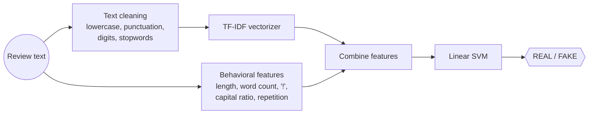

<h1 align="center">🕵️ Fake Review Detector</h1>
<p align="center">Paste a product review and find out if it looks <b>real</b> or <b>computer-generated / fake</b>.<br/>
<b>Python · NLP · scikit-learn · NLTK · Streamlit · Docker</b></p>

---

## Problem

Online stores are flooded with fake reviews that mislead buyers and hurt honest sellers. Reading every review by hand to spot them does not scale.

## Solution

A lightweight NLP classifier that combines **what a review says** (TF-IDF on cleaned text) with **how it is written** (length, exclamation marks, capital letters, word repetition). A Linear SVM trained on a labeled fake-reviews dataset returns a REAL / FAKE verdict instantly in a web app.

## Architecture



## How it works

1. **Cleaning:** lowercase, strip punctuation and digits, remove English stopwords (NLTK).
2. **Text features:** the saved TF-IDF vectorizer turns the cleaned review into a sparse vector.
3. **Writing-style features:** 5 numbers computed on the raw text (length, word count, `!` count, capital ratio, repetition ratio).
4. **Classification:** both feature sets are stacked and passed to the trained Linear SVM.

## Run it in one command

Requires [Docker](https://docs.docker.com/get-docker/).

```bash
git clone https://github.com/OussemaBouchaala/Fake_Real_Reviews_Classifier.git
cd Fake_Real_Reviews_Classifier
docker compose up --build
```

Open http://localhost:8501, paste a review and click **Predict**.

<details>
<summary>Run without Docker</summary>

```bash
python -m venv venv && source venv/bin/activate   # Windows: venv\Scripts\activate
pip install -r requirements.txt
python -m nltk.downloader stopwords
cd app
streamlit run streamlit.py
```
</details>

## Project structure

```
├── app/
│   ├── streamlit.py       # Web app: cleaning, features, prediction
│   ├── text_features.py   # Feature helpers
│   ├── config.py          # Paths loaded from config.json
│   └── utils.py
├── data/                  # Labeled fake reviews dataset
├── models/                # TF-IDF vectorizer and Linear SVM models
├── notebooks/             # EDA, preprocessing and model benchmarking
├── config.json            # Central path configuration
├── Dockerfile
└── docker-compose.yml
```

## Tech stack

Python · scikit-learn (TF-IDF, Linear SVM) · NLTK · NumPy / SciPy · Streamlit · Docker
